# ADHD Budgeting App: MVP Build Plan

October 26, 2026 · Live version: [Claude Doc](https://claude.ai/artifact/Y5VmCCA96msrCtgyb6cY8L) · Companion: [Technical Requirements Document](TECHNICAL_REQUIREMENTS.md)

## Summary

We are building the first version (the MVP) of a budgeting app for adults with ADHD. It answers one question at a glance, **"How much can I safely spend right now?"**, and welcomes people back after a break without guilt.

This plan explains **what we build, in what order, who does what, and what could go wrong**. It is written for stakeholders, designers and developers alike; no coding knowledge is needed. The companion *Technical Requirements Document* covers how the app is built.

- **Who it is for:** *overwhelmed restarters* (people who have quit 2 or more budgeting apps) and *surprise-hit spenders* (people caught out by forgotten bills and impulse buys).
- **How long:** about **14 weeks of building** in seven phases, then a **12-week closed beta** with about 100 testers.
- **What success looks like:** 40% of beta testers still use the app in their fourth week.
- **Our biggest bet:** *manual mode first*. People can use the whole app without linking a bank; bank linking comes last.
- **Not negotiable:** money data is protected from day one, before any feature is built.

## Words used in this plan

| Term | What it means |
|---|---|
| MVP | Minimum viable product: the smallest version that tests whether the idea works for real people |
| Closed beta | An invite-only test with about 100 people before the public launch |
| Safe-to-spend | Your balance minus bills due before payday and money set aside for savings. The app's main number |
| Buckets | Money shown as three containers that fill and empty: Spending, Bills and Savings |
| Manual mode | Using the app by typing your balance and expenses, without linking a bank |
| Bank linking | Connecting a bank account through Plaid so transactions arrive on their own |
| Phase | A block of work that ends with something testers can actually use |
| Gate | The check a phase must pass before the next one starts |
| Development build | A test version of the app installed on a real phone. Needed because of the security features |
| Encryption | Scrambling stored data so only the app, unlocked by its owner, can read it |
| Four screen states | Every screen is designed for *Initial* (empty), *Loading*, *Success* and *Error* |
| Saved once | A tap that is repeated, or a save retried after a dropped connection, still counts only once |

## Goals and how we measure success

The beta exists to answer one question: **does an ADHD-first design keep people budgeting, and bring them back after they lapse?**

| Goal | Target | How we measure it | When |
|---|---|---|---|
| People keep using it | 40% of testers active in week 4 | App opens per tester per week (no money details recorded) | Beta week 4 |
| People come back after a break | 60% of testers who stop for 7+ days return within 30 days | Return visits after a 7-day gap | Beta weeks 4 to 12 |
| Setup is quick | Setup finished in 5 minutes or less | Time from first open to the home screen | Every new tester |
| Fewer money surprises | 30% fewer late fees or overdrafts | Survey at the start and in month 3 | Beta month 3 |
| Built safely | Zero critical security issues open at beta launch | Security checklist and review | Week 14 |

We record *events* ("opened the app", "finished setup"), never amounts, merchants or balances.

## What goes in first

All features below are in the MVP scope, but they are not equally valuable or equally hard. We scored each one so we build the most valuable first and know what to cut if we fall behind.

**How we scored:** *Impact* (1 to 5: how much it moves the goals above) × *Confidence* (how sure we are, from our research) ÷ *Effort* (estimated weeks). Higher score = build sooner. These are team estimates; we revisit them after the design tests in Phase 0.

| Feature | Main goal it serves | Impact | Confidence | Effort (weeks) | Score |
|---|---|---|---|---|---|
| Safe-to-spend number with breakdown | Keep using it; fewer surprises | 5 | 90% | 1 | **4.5** |
| Quick add with undo | Keep using it | 4 | 80% | 1 | **3.2** |
| Bill countdown | Fewer surprises | 4 | 80% | 1 | **3.2** |
| Fresh start after a break | Come back after a break | 5 | 60% | 1 | **3.0** |
| Step progress and autosave in setup | Setup is quick | 4 | 70% | 1 | **2.8** |
| Snoozable reminders | Fewer surprises | 4 | 60% | 1 | 2.4 |
| Goal picker | Setup is quick | 2 | 60% | 0.5 | 2.4 |
| Visual buckets | Keep using it | 3 | 70% | 1 | 2.1 |
| Default categories | Setup is quick | 2 | 50% | 0.5 | 2.0 |
| Weekly check-in | Come back after a break | 3 | 60% | 1 | 1.8 |
| Focus Mode | Keep using it | 3 | 50% | 1 | 1.5 |
| Pause before purchase | Fewer surprises | 3 | 40% | 1 | 1.2 |
| Home-screen widget | Keep using it | 4 | 50% | 2 | 1.0 |
| Recurring bill detection | Setup is quick | 3 | 50% | 1.5 | 1.0 |
| Bank linking and transaction import | Keep using it | 4 | 60% | 3 | 0.8 |

The **security foundation** is not scored: it is required before anything else ships.

### Top 5

1. **Safe-to-spend number.** The core promise of the app. Without it there is nothing to test.
2. **Quick add with undo.** Logging has to take two taps or it will not happen; undo removes the fear of mistakes.
3. **Bill countdown.** Directly targets surprise-hit spenders, one of our two audiences.
4. **Fresh start.** Our clearest difference from competitors. Confidence is lower because no app does it yet, which is exactly why the beta must test it.
5. **Step progress and autosave.** Setup is where ADHD users quit other apps; saving their place protects the first five minutes.

### Trade-offs we made

- **Bank linking scores lowest** because it is the most work and depends on an outside company (Plaid). Manual mode tests the core idea without it, so it is built last.
- **The widget** fights "out of sight, out of mind", but needs separate iPhone and Android work plus privacy masking, so it comes late.
- **Visual buckets score in the middle** but are built early, together with safe-to-spend, because they display the same numbers and set the home screen design.

### If we fall behind, cut in this order

1. Pause before purchase
2. Home-screen widget
3. Recurring bill detection
4. Bank linking (moves to a beta update; the beta runs in manual mode)

The top 5, the buckets and the security foundation are never cut.

## Build phases and timeline

We build in **phases**. Each phase adds one complete, usable piece of the app, so stakeholders can try real progress every two weeks instead of waiting until the end.

```mermaid
gantt
    title Fourteen weeks of building, then a twelve-week closed beta
    dateFormat X
    axisFormat %s
    tickInterval 2second
    section Build
    0. Design and plan      :0, 2
    1. Safe foundation      :2, 4
    2. Money at a glance    :4, 7
    3. Easy start           :7, 9
    4. Calm habits          :9, 11
    5. Accounts and bank    :11, 13
    6. Beta ready           :13, 14
    section Beta
    Beta launch             :milestone, 14, 14
    Closed beta (100 testers) :14, 26
```

The axis counts weeks elapsed (0 = the start of week 1). Security comes first, then the everyday money tools, then setup, then habits, and bank linking last.

| Phase | Weeks | What we build | What a tester can do afterwards | Gate to move on |
|---|---|---|---|---|
| 0. Design and plan | 1 to 2 | Mockups, design system, clickable prototype | Click through setup and home in a prototype | 6 of 8 test users finish prototype setup in 5 minutes |
| 1. Safe foundation | 3 to 4 | App shell, encrypted storage, Face ID or fingerprint unlock, 5-minute lock, privacy blur, rooted-phone check | Install the app, unlock it with their face, see an empty home screen | Security checklist passes |
| 2. Money at a glance | 5 to 7 | Balance, safe-to-spend with breakdown, three buckets, quick add with undo, bills with countdown | Type a balance, add bills, log spending and see the number change | The team uses it daily for a week (internal alpha); all money-math tests pass |
| 3. Easy start | 8 to 9 | Goal picker, 4-step setup with autosave, default categories | A brand-new person sets up the app alone | 5 new people finish setup in 5 minutes or less |
| 4. Calm habits | 10 to 11 | Fresh start, weekly check-in, snoozable reminders, Focus Mode, pause before purchase | Come back after a week away and restart in one tap | Every screen passes the ADHD design checklist |
| 5. Accounts and bank | 12 to 13 | Sign-in and backup, bank linking (test banks), transaction import, bill detection, widget | Link a test bank and see transactions sort themselves | Nothing is lost or doubled when the connection drops mid-save |
| 6. Beta ready | 14 | Accessibility pass, security review, test builds in TestFlight and Google Play, invite testers | Install the beta from an invite | No critical bugs open |

**Note on dates:** the PRD planned the beta for months 2 to 4. With the full scope, this plan starts the beta in **week 15 (early month 4)**. See *Decisions needed* below.

## What design delivers and when

Design stays about one phase ahead of building, so developers never wait for screens. Every screen is delivered in its **four states** (Initial, Loading, Success, Error), in light and dark mode.

| Needed by | Design delivers | Why it matters |
|---|---|---|
| Week 2 | Design tokens (colours, type, spacing), core components (button, money card, bucket, helper text), clickable prototype of setup and home | Sets the look once so every screen stays consistent; the prototype is tested with 8 people at the Phase 0 gate |
| Week 3 | Lock screen, privacy cover shown in the app switcher, "this phone is not supported" screen | Security screens must feel calm, not alarming |
| Week 5 | Home with safe-to-spend and buckets, breakdown, quick add sheet, bills list | The heart of the app |
| Week 8 | Goal picker, 4-step setup with progress, category icons | First impressions decide whether people stay |
| Week 10 | Fresh start, weekly check-in, reminder settings and wording, Focus Mode, pause prompt; short success animations (under 1 second) plus still versions for reduced motion | The habits that bring people back |
| Week 12 | Home-screen widget ("Tap to view" by default), bank-linking explainer, settings | Privacy choices must be clear and easy to change |

**Design rules for every screen:** one decision per screen; no red alarms or shaming words; text at least 16 point in Atkinson Hyperlegible or Lato; buttons at least 44 × 44 point; colour always paired with a word (teal Spending, indigo Bills); amounts hidden outside the app unless the user chooses to show them.

## Who does what

| Role | Responsible for | Decides |
|---|---|---|
| Product manager | This plan, scope, priorities, beta recruiting, success metrics, phase gate reviews | What is built next and what gets cut |
| Product designer | User flows, mockups, design system, usability tests, wording (with the PM) | How each screen looks and reads |
| Mobile developer(s), working with Claude Code | Building each phase, automated tests, test builds on real phones | How it is built, within the technical requirements |
| Security and data reviewer | Signing off the security checklist at Phase 1 and Phase 6 | Whether a phase is safe to release |
| Instructor and stakeholders | Reviewing each phase demo; approving scope or date changes | Go or no-go at each gate |
| Beta testers (adults with ADHD) | Using the app, short surveys, optional interviews | What actually helps them |
| ADHD advisor (optional) | Reviewing wording for shame-free, clear language | Whether copy fits our audience |

## Risks: a pre-mortem

A pre-mortem imagines the project has already failed and asks why. Picture this: *it is four weeks into the beta and almost nobody is using the app.* What went wrong?

We sort each answer into three kinds:

- **Tigers:** real risks we can see clearly. They need action.
- **Paper tigers:** worries that sound serious but we believe are overblown.
- **Elephants:** things nobody is talking about that might matter.

### Tigers

| # | Risk | Why we think it is real | Urgency | What we do about it |
|---|---|---|---|---|
| T1 | Too much scope for the time | The full scope needs about 14 weeks; the PRD hoped for a beta in months 2 to 4 | **Launch-blocking** | Agree the cut order now and check it at every gate |
| T2 | Not enough testers with ADHD | We need about 100 active testers and have no waitlist yet | **Launch-blocking** | Start recruiting in week 6; aim for 150 sign-ups |
| T3 | Security work slows the team | Encryption, biometrics and test builds are new to the team | **Launch-blocking** | Build it first, as its own phase, with a ready-made checklist; flag any overrun at the week 4 gate |
| T4 | App store review delays the beta | Finance apps get extra privacy checks before external testing | **Launch-blocking** | Prepare privacy labels, a delete-my-data option and a reviewer test account by week 13 |
| T5 | The 5-minute lock annoys people | Security asks for it; ADHD design asks for speed | Fast-follow | Fast face unlock that returns people to the exact screen; watch complaints in the alpha |
| T6 | Testers cannot link real banks | Plaid's real-bank access needs approval and has costs; the beta uses test banks | Fast-follow | The beta runs on manual mode; apply for real-bank access during the beta |
| T7 | People turn notifications off | Many users deny notification permission | Track | Bills also count down inside the app; ask for permission only when a reminder is switched on |

### Paper tigers

- **"PocketGuard already shows a left-to-spend number."** True, but our difference is the fresh start, calm design and the purchase pause. The number is expected, not our edge.
- **"No one will use it without linking a bank."** Many people do not trust bank linking. Manual mode serves them, and the beta will show how many link later.
- **"Encryption will make the app slow."** The amount of data is small; encrypted storage is not noticeably slower at this size.
- **"It needs charts and reports to look like a real finance app."** Our research says busy dashboards overwhelm this audience. Reports stay out of the MVP.

### Elephants

- **Are we giving financial advice by accident?** A phrase like "you can afford this" could read as advice. *Check:* review all wording against "budgeting tools only" before the beta.
- **What if the number is wrong?** If people forget to log cash, safe-to-spend drifts and trust drops. *Check:* in the alpha, compare the app's number with real balances each week.
- **Who runs the app after the course?** Real people's data needs ongoing care, support and hosting costs. *Check:* decide before inviting testers.
- **Is the name final?** "FocusFinance" is not confirmed. *Check:* decide and check the name is free before store listings.
- **Who exactly is it for?** Should autistic adults and other neurodivergent people be included? *Check:* decide before recruiting starts.

### Action plans for launch-blocking risks

| Risk | Action | Owner | Due |
|---|---|---|---|
| T1 Scope | Agree phase gates and the cut order with the instructor | Product manager | Week 1 |
| T2 Testers | Open a waitlist; post in 3 ADHD communities; reach 150 sign-ups | Product manager | Start week 6, done week 12 |
| T3 Security | Finish the Phase 1 security checklist before any feature work | Mobile developer | Week 4 |
| T4 Store review | Privacy labels, delete-my-data, reviewer account, submit beta build | Product manager and developer | Week 13 |

We revisit this list at the week 12 gate, three weeks before the beta.

## Decisions needed from stakeholders

| Decision | Options | Recommendation | Needed by |
|---|---|---|---|
| When does the beta start? | (a) Week 15 with the full scope; (b) keep an earlier date and ship Phase 5 (bank linking, widget) as a beta update | **(a)**, unless the date matters more than bank linking; then (b) | Week 1 |
| Is "FocusFinance" the product name? | Keep it, or choose another | Decide early; the name appears on the store listing and invites | Week 12 |
| How long before the app locks itself? | 5 minutes (requirements document), or longer | Keep 5 minutes; review with alpha feedback | Week 7 |
| Who is the beta for? | Adults with ADHD only, or neurodivergent adults more broadly | ADHD first, so the results are clear; widen after the beta | Week 6 |
| Who looks after the app and its data after the course? | Team member, instructor programme, or end the beta with data deleted | Agree before any real person's data is stored | Week 13 |

## How we know a phase is done

A phase is finished only when all of these are true. We show them in a short demo at each gate.

- [ ] It works on a real phone, not just on a computer.
- [ ] Automated tests pass, and the "what if it goes wrong" cases were written first.
- [ ] Every new screen has its four states and passes the ADHD design checklist.
- [ ] The security checklist passes: money data is only ever stored encrypted.
- [ ] It works with a screen reader, with the largest text size, and with reduced motion.
- [ ] The phase's gate (in the timeline table) is met.

The full engineering detail behind each item is in the [Technical Requirements Document](TECHNICAL_REQUIREMENTS.md).
