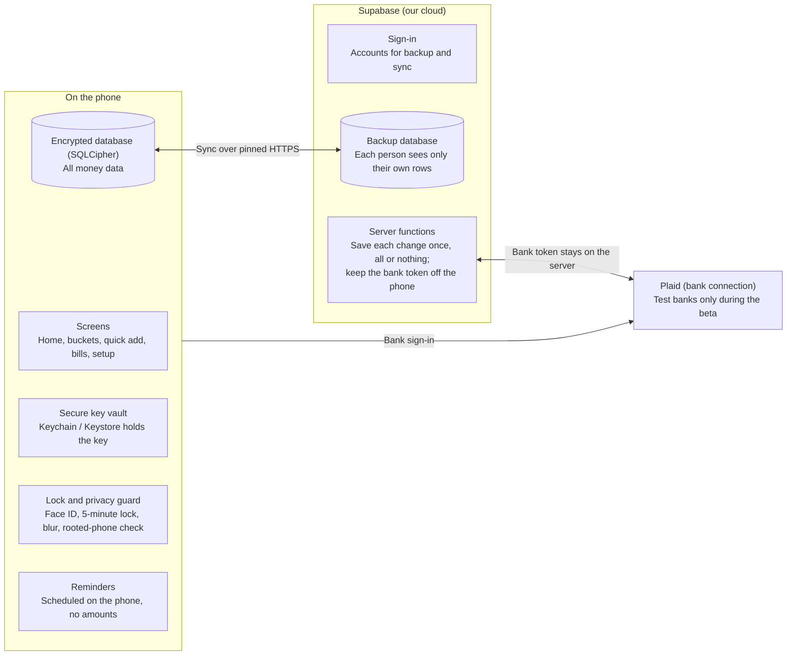

# ADHD Budgeting App: Technical Requirements Document

October 26, 2026 · Live version: [Claude Doc](https://claude.ai/artifact/4VcmUf4F1SqpUGkh7Se8e8) · Companion: [MVP Build Plan](BUILD_PLAN.md)

## Purpose and how to read this document

This document says **what the app must do and how it must behave** so it can be built, tested and trusted. It sits beside the *MVP Build Plan* (which says when and in what order) and the security requirements in [`BANKING_PRD_TECHNICAL_REQUIREMENTS.md`](BANKING_PRD_TECHNICAL_REQUIREMENTS.md).

**Who it is for:**

- **Stakeholders:** read the plain-language column in each table and skip the technical names in brackets.
- **Designers:** the functional requirements and the design section list the screens, states and rules you design for.
- **Developers:** every requirement has an ID (for example **FR-03** or **SEC-02**) to reference in tasks, tests and code reviews.

Requirements use **must** for things the beta cannot ship without and **should** for things we aim for but could defer.

## How the system fits together

The app is **local-first**: everything a person needs works on their phone, even with no internet. The cloud is used for sign-in, backup and bank linking.

- **On the phone:** the screens, an encrypted database holding all money data, a secure vault (built into iPhone and Android) holding the key to that database, the lock and privacy guard, and reminders.
- **Supabase (our cloud):** accounts, a backup copy of each person's data that only they can see, and small server functions that save every change exactly once.
- **Plaid:** connects to banks. The person signs in to their bank inside Plaid's own screen; our server, not the phone, keeps the resulting bank token.
- **Connections:** all traffic uses encrypted HTTPS, and the app only talks to servers whose identity it recognises ("pinned").

## Technology choices

| Part | Choice (technical name) | Why, in plain words |
|---|---|---|
| App | Expo (React Native) with TypeScript | One app for iPhone and Android; TypeScript catches mistakes before users see them |
| Screens and navigation | Expo Router | Screens are organised like folders; supports pop-up sheets for quick add |
| Test versions on phones | Development build (expo-dev-client), built with EAS | The security features need a real build; the simpler Expo Go app cannot run them |
| Storage on the phone | expo-sqlite with SQLCipher (AES-256 encryption) | Works with no internet; scrambled so a lost phone does not expose money data |
| Key storage | expo-secure-store (iPhone Keychain, Android Keystore) | The phone's built-in safe for the database key |
| Unlock | expo-local-authentication | Face ID or fingerprint, with the phone passcode as a fallback |
| Privacy cover | expo-blur | Hides amounts in the app switcher |
| Unsafe phone check | jail-monkey | Spots phones whose built-in protections were removed |
| Trusted connections | react-native-ssl-public-key-pinning | The app talks only to our real servers |
| Animation | Reanimated and Lottie | Short, calm confirmations that switch off with reduced motion |
| Reminders | expo-notifications (scheduled on the phone) | Reminders work without our servers |
| Cloud | Supabase: sign-in, Postgres database with row-level security, Edge Functions | Backup, sync and safe saving, with each person locked to their own data |
| Bank data | Plaid (test mode during the beta) | Trusted bank connection used by most budgeting apps |
| Automated tests | Jest and React Native Testing Library | Checks behaviour the way a user experiences it |
| Release hardening | Hermes engine, R8 code shrinking, logs removed | Makes the app harder to pick apart and keeps data out of logs |

## Functional requirements

What each feature **must** do. "Done when" is how testers and stakeholders check it. Phase numbers match the *MVP Build Plan*.

| ID | Feature | The app must | Done when | Phase |
|---|---|---|---|---|
| FR-01 | Safe-to-spend | Show the safe-to-spend number first on the home screen; a tap shows how it was worked out | Number = balance − unpaid bills due before payday (or the next 30 days) − savings set aside. Below zero shows $0 and a calm note, never a red negative | 2 |
| FR-02 | Visual buckets | Show Spending, Bills and Savings as buckets; let people move money between Spending and Savings | Buckets always add up to the balance; a move counts once even if tapped twice, and can be undone | 2 |
| FR-03 | Quick add | Log a cash expense in 2 taps; category optional | Two taps from home; an undo option appears after every add and delete | 2 |
| FR-04 | Bill countdown | List bills due in the next 7 days, soonest first, with days left | "Due today" for day 0; marking a repeating bill paid moves it to its next date | 2 |
| FR-05 | Manual mode | Let people type a balance instead of linking a bank | Every feature except import works without a bank; linking can happen later in settings | 2 |
| FR-06 | Goal picker | Offer 3 simple goals | One tap to choose; the home screen order follows the goal | 3 |
| FR-07 | Default categories | Provide 5 starter categories (bills, food, fun, transport, other) | None are required during setup | 3 |
| FR-08 | Step progress and autosave | Show "Step N of 4" and save after every step | Closing the app, or the automatic lock, returns the person to the same step | 3 |
| FR-09 | Fresh start | After 7+ days away, offer a one-tap restart | Old uncategorised items move to "other" and the week restarts; the app never says how long the person was away | 4 |
| FR-10 | Weekly check-in | Run a 60-second review on a day and time the person chooses | Celebrated when done; no streaks anywhere | 4 |
| FR-11 | Reminders | Remind about bills at a chosen lead time | Snooze (1 hour, tomorrow), mark paid, mute; quiet hours 21:00 to 08:00; no amounts unless switched on | 4 |
| FR-12 | Pause before purchase | Optional prompt above an amount the person sets | Offers a 24-hour wishlist instead of buying now | 4 |
| FR-13 | Focus Mode | Hide everything except safe-to-spend and quick add | Motion and sound can be switched off | 4 |
| FR-14 | Transaction import | Import and sort bank transactions | Each is given a category; a corrected category is remembered for that merchant | 5 |
| FR-15 | Bill detection | Suggest likely repeating bills from imported transactions | Same merchant, 2+ times, amounts within 10%, about weekly, fortnightly, monthly or yearly; the person confirms each, nothing added silently | 5 |
| FR-16 | Home-screen widget | Give a shortcut to safe-to-spend and quick add | Shows "Tap to view" by default; the amount appears only if the person opts in | 5 |
| FR-17 | Account and data control | Offer sign-in for backup and a "delete my data" option | Deleting removes the cloud copy and the data on the phone | 5 |

## Data: what we store and how it is protected

| Data | Where it lives | How it is protected |
|---|---|---|
| Balances, expenses, bills, buckets, categories | The phone's encrypted database; a backup copy in Supabase if the person signs in | Encrypted on the phone; in the cloud each person can see only their own rows; sent only over HTTPS |
| Setup progress and unfinished entries | The phone's encrypted database | Encrypted, so the lock never loses someone's place |
| Database key | The phone's secure vault | Never leaves the phone and is never backed up |
| Sign-in session | The phone's secure vault | Cleared when the person signs out |
| Plaid bank token | Our server only | Never sent to the phone |
| Display preferences (theme, reduced motion) | Simple phone storage | Not sensitive, so no encryption needed |
| Usage events | Analytics | Event names only ("finished setup"); never amounts, merchants or balances |

**We never store:** bank passwords (Plaid handles them), card numbers or government ID numbers.

**Rules for every developer:**

- Money is stored as whole cents (1250 = $12.50) so totals are never off by a fraction of a cent.
- Each record gets a unique ID created on the phone, which also stops it being saved twice.
- Logs and error reports never contain personal or money data.

## Security and privacy requirements

All of these are **must** for the beta. The security foundation is built first (Phase 1) and reviewed again before launch (Phase 6).

| ID | Requirement | In plain words |
|---|---|---|
| SEC-01 | Encrypt the phone's database with SQLCipher (AES-256); keep the key in Keychain or Keystore | A lost or stolen phone does not reveal anyone's money |
| SEC-02 | No financial or personal data in simple storage (AsyncStorage), logs, web addresses or notification contents | Sensitive data lives in one protected place only |
| SEC-03 | Unlock with Face ID or fingerprint, with the phone passcode as a fallback | Only the owner opens the app; nobody gets stuck |
| SEC-04 | Lock after 5 minutes without use; clear sensitive data from memory; return to the same screen after unlock | A phone left on a table is safe, and nothing is lost |
| SEC-05 | Cover the screen with a blur when the app goes to the background | Amounts do not show in the app switcher |
| SEC-06 | Block rooted or jailbroken phones with a calm explanation screen | Phones with removed protections cannot keep data safe |
| SEC-07 | HTTPS only; TLS 1.3 on our servers; certificate pinning with a backup pin | Nobody can listen in or pretend to be our server |
| SEC-08 | No `console` logging in release builds; code shrinking and obfuscation (R8, Hermes) | The released app gives away as little as possible |
| SEC-09 | Every save that changes money carries a unique key (`X-Idempotency-Key`) | A double tap or a retried save counts only once |
| SEC-10 | Saves that change several things happen in one transaction that rolls back on failure | Money is never half-moved |
| SEC-11 | No secrets in the app or the repository; the Plaid secret lives only on the server | Keys cannot be copied out of the app |
| SEC-12 | Row-level security on every cloud table | Each person can reach only their own data |
| SEC-13 | Widget, notifications and app switcher show no amounts unless the person opts in | Money stays private on a lock screen or a shared desk |

## Design, accessibility and wording requirements

Our users find planning, memory and focus hard, and money needs all three. These rules keep every screen low-effort and free of shame.

| ID | Requirement | Why |
|---|---|---|
| UX-01 | Every screen that loads or saves data is designed in four states: Initial, Loading, Success and Error | Nobody is left staring at a blank or broken screen |
| UX-02 | One decision per screen; secondary details appear on tap | Fewer choices means less overwhelm |
| UX-03 | Body text at least 16 point, Atkinson Hyperlegible or Lato, line height about 1.5; helper text never italic | Easy to read when attention is low |
| UX-04 | Contrast at least WCAG AA (4.5 to 1); light and dark mode | Readable for everyone, in any light |
| UX-05 | Touch targets at least 44 × 44 point | Easy to hit when rushing |
| UX-06 | Colour always comes with a word or icon (teal Spending, indigo Bills) | Works for colour-blind users |
| UX-07 | One short helper sentence beside a control the first times it matters, which can be hidden later | Coaching exactly when it is needed |
| UX-08 | Success animations under 1 second; replaced by a still message when reduced motion is on | Small wins without overstimulation |
| UX-09 | Shame-free wording (examples below); no red alarms, no streaks | Slips should not push people away |
| UX-10 | Every control has a screen-reader label; amounts are read as words ("120 dollars") | Works with VoiceOver and TalkBack |
| UX-11 | Respects the phone's text size up to the largest setting | Nothing is cut off for people who need big text |
| UX-12 | No pop-ups in the middle of a task; buttons say what they do ("Add expense", not "Next") | Keeps people moving |

| Instead of | We write |
|---|---|
| "You're over budget" | "Here's where things landed this week" |
| "You missed 12 days" | "Welcome back. Want a fresh start?" |
| "Session expired" | "Locked to keep your money private. Unlock to pick up where you left off." |
| "Network error" | "We couldn't save that just now. Your entry is safe; we'll try again." |
| "Error: invalid input" | "That amount needs a number, like 12.50" |

## Speed, reliability and offline

| ID | Requirement | Level |
|---|---|---|
| PERF-01 | Checking safe-to-spend, from unlocking to seeing the number, takes under 5 seconds | Must |
| PERF-02 | The app reaches the unlock screen in under 2 seconds on a mid-range phone | Should |
| PERF-03 | Quick add saves in under 1 second | Should |
| PERF-04 | Lists scroll smoothly with 1,000 transactions | Should |
| REL-01 | Everything except bank import and sync works with no internet; changes sync when the phone is back online | Must |
| REL-02 | Nothing is lost or half-saved if the app closes or the phone switches off mid-save | Must |
| REL-03 | Retrying a save never creates a duplicate | Must |
| REL-04 | At least 99% of beta sessions end without a crash; crash reports contain no personal data | Should |
| REL-05 | Supports the current and previous major versions of iOS, and Android 10 or later (to confirm in Phase 0) | Should |

## Outside services

### Supabase (our cloud)

- **Sign-in is optional.** It is needed only for backup and bank linking, so manual mode works without an account.
- **Database:** Postgres with row-level security on every table.
- **Saving money changes:** through Edge Functions or database functions that check the unique save key and run as one transaction (SEC-09, SEC-10). The standard Supabase data API cannot check save keys, so it is not used for money changes.

### Plaid (bank connection)

1. Our server asks Plaid for a one-time link token.
2. The person signs in to their bank inside Plaid's own screen in the app.
3. Plaid returns a temporary token, which the app hands straight to our server.
4. Our server exchanges it for the long-lived bank token and keeps that token itself.
5. Our server fetches transactions and sends them to the phone over HTTPS.

The beta uses Plaid's **test mode (sandbox)** with practice banks. Real banks need Plaid's approval; we apply during the beta.

### Reminders

- Scheduled on the phone (local notifications), so they work without our servers.
- Permission is asked only when someone first turns on a reminder, never at first launch.
- Notification text has no amounts by default; it carries only an ID, and the app looks up details after unlock.
- Reminders are rescheduled every time the app starts, in case the phone cleared them.

### App stores

Beta builds go out through **TestFlight** (iPhone) and **Google Play internal testing** (Android).

## Testing and quality checks

We test what could go wrong **before** we test the happy path: no internet, a timeout, a typo in an amount, a double tap.

| Check | What it proves | When |
|---|---|---|
| Money-math tests | Safe-to-spend, buckets and bill dates are always correct (for example: three 10-cent items add up to exactly 30 cents; a bill after payday is not counted) | Written before the code, every change |
| Screen tests | Each screen works the way a person uses it, in all four states | Every change |
| Security tests | A double tap creates one record; a failed save rolls back; the app locks after 5 minutes; the blur appears in the background; nothing sensitive is in simple storage | Every change |
| Automatic checks (CI) | Type check, lint (fails on any leftover `console` log) and all tests pass on GitHub | Every push |
| Accessibility check | Screen reader, largest text size and reduced motion all work through setup, safe-to-spend, quick add and undo | Each phase |
| Real-phone check | Works on an actual iPhone and Android phone | Each phase |
| Security review | The full security checklist (SEC-01 to SEC-13) | Phases 1 and 6 |
| Beta feedback | In-app feedback, short surveys, crash reports | Throughout the beta |

## Environments and release

| Environment | Who uses it | Bank data | Cloud |
|---|---|---|---|
| Development | Developers | Plaid test banks | Development Supabase project |
| Internal alpha (from week 7) | The team | Plaid test banks; manual mode for real spending | Staging Supabase project |
| Closed beta (from week 15) | About 100 invited testers | Plaid test banks; manual mode for real spending | Production Supabase project, holding real people's data |

**Every release must:** pass code review and the automatic checks, meet the build plan's definition of done, and keep keys in EAS environment variables (never in the code). Because the beta holds real people's data, the Phase 6 security review is required before the first invite goes out.

## Assumptions, limits and open questions

**Assumptions**

- A small team (product manager, designer, one or two developers working with Claude Code).
- Free or starter tiers of Supabase and Plaid cover about 100 testers.
- Test banks are enough for the beta, because manual mode carries real spending.

**Known limits**

- The app cannot force TLS 1.3 on older phones. Our servers require it where possible, and certificate pinning protects older connections.
- Rooted and jailbroken checks catch most, not all, unsafe phones.
- Face ID and fingerprint depend on the phone, which is why the passcode fallback is required.
- The sample balance component in the security requirements file is not used as written: it uses 12 and 14 point italic text and stores the balance as text. We use 16 point or larger, never italic, and whole cents.

**Open questions**

| Question | Recommendation | Decide by |
|---|---|---|
| Is 5 minutes the right lock time for ADHD users? | Keep 5 minutes; review alpha feedback | Week 7 |
| Should an account be required? | No; optional, for backup and bank linking | Week 2 |
| Minimum phone versions? | Current and previous iOS; Android 10 or later | Week 2 |
| Which crash-reporting tool? | One that can strip personal data before sending | Week 12 |
| What happens to beta data after the beta? | Delete it, or ask testers before keeping it | Week 13 |
