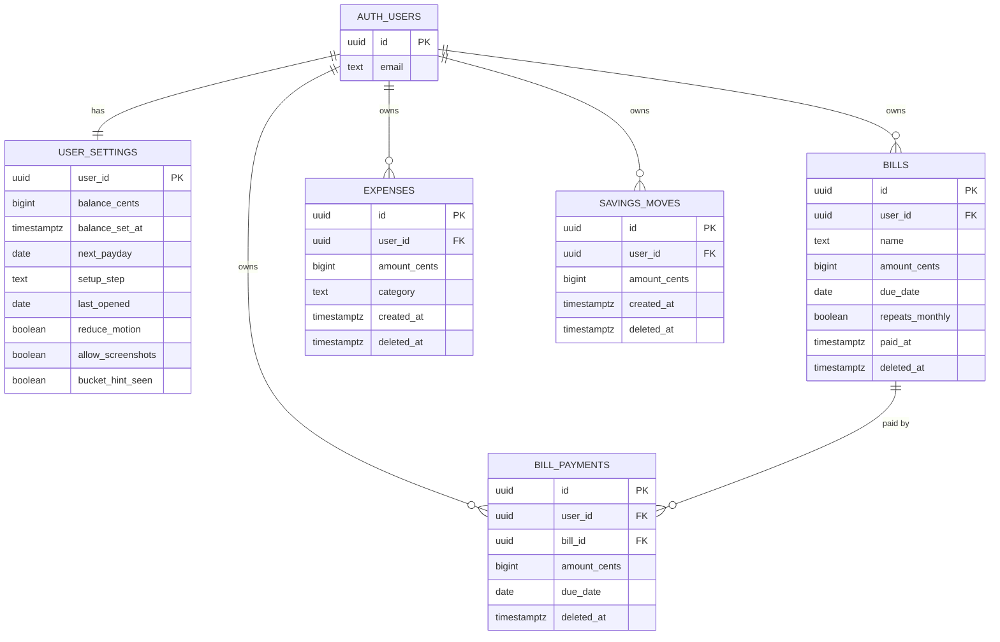

# Database Diagram

The ADHD Financial App stores its data in Supabase (Postgres). Every table is locked with row-level security, so each person can reach only their own rows. Money is stored as whole cents.

The SQL that builds this database is in [`steady-money/supabase/migrations`](../steady-money/supabase/migrations).

## What each table holds

| Table | What it holds |
| --- | --- |
| `auth.users` | Accounts, managed by Supabase Auth |
| `user_settings` | One row per person: typed balance, next payday, setup step and preferences |
| `bills` | Each bill, with its next due date |
| `bill_payments` | A record each time a bill is marked paid, so Undo can reverse it |
| `expenses` | Each quick add. Removing one sets `deleted_at`, so Undo can bring it back |
| `savings_moves` | Money moved into Savings (positive) or back to Spending (negative) |

The tables also have `created_at` and `updated_at` columns, left out above to keep the diagram readable.

Prepared by Robert Wills · © 2026
